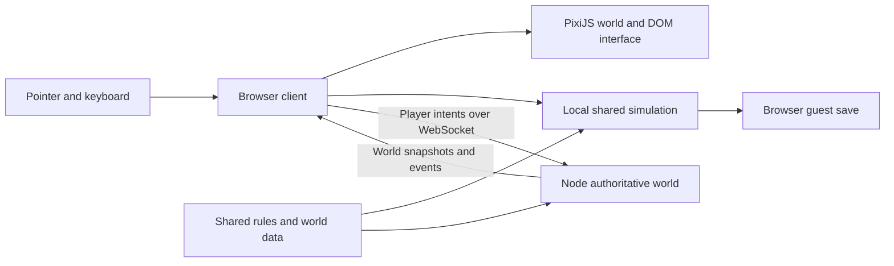

# Technical architecture

The first slice is a browser-native, classic-inspired isometric action RPG. It keeps the playable world model independent of rendering so the same rules can run in a local solo session or an authoritative Node server. Art and world layouts are created for this project. Historical client interoperability is a later, isolated capability.

## Runtime boundary



| Layer               | Current role                                                                                                            | Extension boundary                                                     |
| ------------------- | ----------------------------------------------------------------------------------------------------------------------- | ---------------------------------------------------------------------- |
| Browser application | Vite with JavaScript modules; input, HUD, inventory/NPC windows and session mode                                        | Typed interfaces, accessibility, mobile input                          |
| `src/renderer.js`   | PixiJS v8; original generated art and procedural terrain, visible terrain chunks, isometric entities and visual effects | Remote chunk manifests, measured budgets, glTF characters              |
| `shared/world.js`   | World creation, player commands, resource/combat rules and progression                                                  | Versioned ruleset data and deterministic replay fixtures               |
| `server/index.js`   | Node `ws`; validates intents and advances the authoritative world                                                       | Persistent identities, transactions, interest management and instances |
| Persistence         | Browser storage for a guest's solo progress                                                                             | Server-owned character/economy database and migrations                 |

The optional server owns multiplayer outcomes. A browser sends an action such as movement, jump, attack or inventory interaction; it does not supply final damage, loot or a replacement player state. Solo mode runs the same world rules locally and is a development/playability feature, not a multiplayer authority.

## Geometry and rendering

Gameplay coordinates live in the map's logical cell space. The chosen 2:1 diamond projection uses 64 × 32 pixel cells before zoom:

```text
screenX = (worldX - worldY) * 32
screenY = (worldX + worldY) * 16

worldX = screenX / 64 + screenY / 32
worldY = screenY / 32 - screenX / 64
```

Camera translation and zoom are applied after projection and removed before inverse projection. A click is resolved to logical coordinates before validating movement. The tile dimensions are this project's scale choice; they are not asserted to match every original client build.

Jumping has a legal start and destination in world state. Rendering interpolates between projected endpoints and adds a visual parabola, `4 * apex * u * (1 - u)`. Visual height must never expand collision or attack range. Resource, destination and distance rules belong in shared simulation and are therefore enforceable by the server.

The current two zones are 48 × 48 logical cells. Walking/running follows an eight-neighbor A* path with diagonal corner checks, then advances at 4.5/7.5 cells per second. Jumping costs 10 stamina, is limited to 16 cells, and takes `0.45 + distance * 0.012` seconds. A landing must be passable; sampled intermediate obstacles taller than the prototype's height threshold block the jump. These values are prototype rules. The runtime interpolates fractional positions along legal cell paths rather than preserving integer positions at every tick.

Terrain and scenery are separate from entity state. The renderer builds visible 8 × 8 terrain chunks from original Canvas textures. It keeps visible chunks and evicts the least recently displayed hidden textures when the cache exceeds `max(90, visibleChunkCount)`. This bounds retained hidden chunks while allowing a large viewport to keep the terrain it needs. Objects are depth-sorted by their projected ground baseline; roofs become translucent when the character is behind their footprint. A jumping character's visual height remains separate from its ground shadow.

Original temple, tree, gate, body, equipment, character, pheasant and interface artwork lives in `public/art/` and loads through Pixi assets using Vite's base URL. Procedural Canvas artwork remains available as a fallback. Ambient shade and lantern light sit above the terrain without altering logical coordinates or collision. Generation briefs are recorded in [the art notes](../public/art/README.md).

The current compact authored world avoids a monolithic map texture. Its chunks are generated locally, not downloaded from a historical puzzle archive. A larger world should retain that structure and add an immutable remote chunk manifest, compact collision/elevation grid, viewport chunk selection and measured GPU budget. Downloading every chunk or pre-stitching a giant PNG would remove the memory benefit.

## Equipment state and appearance

An inventory item owns its stats and an optional appearance descriptor; `player.equipment` maps each slot to an inventory item ID. The eight independent slots are `weapon`, `offhand`, `armor`, `helmet`, `boots`, `garment`, `ring` and `necklace`. `equip {itemId}` changes only that item's slot, toggling it off if it is already equipped. `unequip {slot}` explicitly clears one slot. Other equipped pieces remain in place.

```json
{
  "id": "hero-armor-iron",
  "name": "Crimson iron armor",
  "slot": "armor",
  "defense": 11,
  "plus": 0,
  "appearance": {
    "model": "heavy-armor",
    "type": "crimson-iron",
    "color": "#a9584e",
    "trim": "#d7b26c"
  }
}
```

Appearance supports a model, variant type, base color and optional trim, glow and grip. Model/type/grip values come from project allowlists; colors use six-digit hex values. These descriptors select original art and geometry rather than reference proprietary model IDs.

World players use a plain unarmed body inside a Pixi container. Separate sprites render armor, helmet, boots, garment, main weapon and offhand; removing a piece hides that layer. The original equipment atlas supplies clothing, sword and shield textures. Procedural Canvas geometry supplies bows, staffs, glaives, spears, daggers, orbs and quivers. Cached material variants preserve painted shading while applying the item's color and trim.

The appearance signature includes equipped item IDs, +N tiers and descriptors, so changed equipment refreshes the affected avatar. The cape has independent walking motion. A necklace draws a chest jewel; glow descriptors add a restrained floor ring and motes. `equipmentPreview(player)` extracts the same refreshed world avatar at higher resolution for the inventory paperdoll. NPCs and monsters retain their separate character atlas frames.

This is a modular 2.5D sprite renderer. Fully rigged 3D bodies, skinned equipment, motion retargeting and glTF/C3 conversion are future extensions to the same slot/state boundary.

Each class starts with its weapon, armor and boots equipped. Its bag also contains alternative weapons, armor, boots, a helmet, capes, a class-appropriate offhand and a Jade pendant. The quest rewards a separate Phoenix ring. Derived attack/defense sum equipped item stats; the prototype's +N bonus adds four attack and two defense per tier when the item has the corresponding positive base stat.

Composition at Master Wu targets the piece selected in the equipment panel, consumes one stone and 25 silver, and adds one tier up to +12. The server accepts all equipment slots with a positive attack or defense stat. This is a prototype progression rule, not the original stone-point table. Successful mutations return equipment/stat acknowledgements; the online panel refreshes from the next authoritative snapshot. Browser save hydration adds missing wardrobe options for older saves without refilling consumables.

## Protocol and state

The WebSocket messages are a project-specific JSON protocol. They are independent of original `MsgWalk`, `MsgAction`, account-server handshakes, packet seals and cipher state. They do not connect to Comet, CoEmu, an official Conquer server, or an unmodified historical client.

The server advances a world at 20 Hz and publishes authoritative snapshots filtered to the player's zone. The browser renders that state on its own animation clock. A fast display refresh does not imply a faster simulation tick or lower network latency. Full zone snapshots prioritize a small readable implementation; finer area-of-interest filtering and delta snapshots are required before scaling the population.

The current client messages include:

```jsonl
{"type":"join","name":"Wanderer","classId":"trojan"}
{"type":"command","command":{"type":"jump","x":28,"y":24}}
{"type":"command","command":{"type":"equip","itemId":"hero-armor-iron"}}
{"type":"command","command":{"type":"unequip","slot":"helmet"}}
{"type":"chat","text":"Ready for the fields?"}
{"type":"ping","timestamp":123456}
```

`welcome` supplies a generated session ID and initial state. `state` replaces the latest snapshot. `result` contains a nested command result with `ok`, `message` and optional interaction data. `chat` contains flat name/text fields; `pong` echoes the timestamp. These sessions are ephemeral; leaving and rejoining creates a new multiplayer character.

For the next networking iteration, add a monotonic input sequence and server acknowledgement, then a bounded history of unacknowledged commands for local prediction and reconciliation. Keep remote entity interpolation separate. Treat malformed commands, impossible destinations, depleted resources, duplicate inventory operations, excessive message rates and disconnects as explicit server cases.

## Deployment

`npm run build` produces the static browser application in `dist/`. A static host can run solo mode without a backend. Vite uses a relative asset base so the bundle can live beneath a GitHub Pages repository path. The [public playable build](https://vgcman16.github.io/conquer-web/) is published from the [repository](https://github.com/vgcman16/conquer-web)'s prebuilt `gh-pages` branch. Publishing built files keeps this preview available when GitHub Actions cannot run; local verification still precedes each publication.

`npm run server` starts the world service on port 8787, bound to `0.0.0.0`. Set `PORT` to choose a different port. `/health` reports readiness and active population. When `dist/index.html` exists, the same Node process serves the browser build; `STATIC_DIR` can select another frontend directory. The Docker image includes that build, so one deployment serves both frontend and WebSocket world.

A public multiplayer deployment needs a long-running WebSocket-capable process and TLS termination. An HTTPS browser page should use a `wss://` endpoint. A static GitHub Pages preview provides solo play and can connect to a realm hosted elsewhere. The local `ws://127.0.0.1:8787` endpoint is for local development.

The prototype server caps messages at 4 KiB, limits per-connection command traffic, checks WebSocket liveness, and skips sending to clients with a large outbound backlog. These guardrails do not replace authenticated sessions, deployment policy, durable transactions or load testing.

Before a persistent multiplayer launch, make character mutations transactional, retain server-owned identities across reconnects, and record world/economy events sufficiently to recover state. A single process with in-memory sessions is a useful prototype, but it does not establish production durability or MMO concurrency.

## Historical compatibility option

If exact 5017 or 5065 behavior becomes the selected target, pin that build in a separate ruleset. Add a converter for supported, lawfully available fixtures that emits the project's own map/item/animation schemas; keep source assets external to the repository. A legacy server adapter should translate historical packets into the same intent/event boundary rather than expose binary offsets throughout the renderer.

Add Rust/WASM or a second 3D renderer only after an actual parser/animation requirement or profile identifies a bottleneck. The existing browser loop remains useful while compatibility research proceeds. See [research notes](research-notes.md) for verified upstream scope and [roadmap](roadmap.md) for acceptance milestones.
